# Canovaccio

**Compose, arrange and play: tracks and linked segments, piano roll and real notation in sync, chords and guitar
chords with strum, chord track with Yamaha style accompaniment, MIDI keyboard recording, import from MIDI, MuseScore,
MusicXML and Rosegarden.**

Runs on Linux, Windows and macOS (Apple Silicon).

Canovaccio opens your MIDI files, scores and keyboard styles, lets you edit them as a grid or as sheet music, and plays
them through its built-in synthesizer or through your hardware keyboard. It is written in Python with GTK 4 and follows your
desktop's GTK theme.

How it was built: [Building a music editor in Python and GTK 4: exact time, real notation and reverse-engineered
styles](https://medium.com/@antoniogallo.it/building-a-music-editor-in-python-and-gtk-4-exact-time-real-notation-and-reverse-engineered-43151bddffa2)
(Medium).

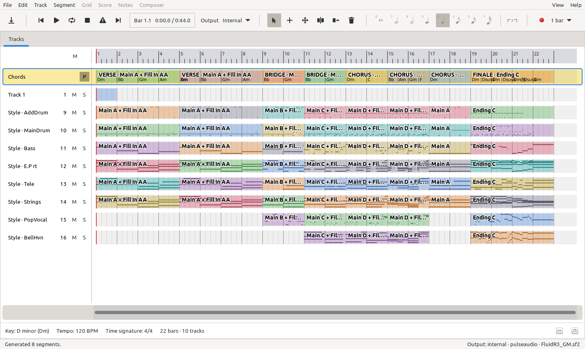


## What it does

- **Arrange** your song in tracks and segments: move, split, resize, merge, label, duplicate as linked copies (clones).
- **Edit notes** in a piano-roll **grid** or directly on the **staff**: create, move, transpose, quantize, tie, slur,
  staccato, velocity — with full undo/redo.
- **Read and write real notation**: key and time signatures, ties, triplets, automatic beaming, chord symbols,
  drawn with the SMuFL font Bravura.
- **Write chords fast**: insert a chord by name, a guitar chord from the chord book (with strum), or let the editor
  **detect the chords** from the notes you played.
- **Accompany yourself**: a **chord track** plus **Yamaha styles** generate drums, bass and chords that follow your
  chord progression.
- **Play it anywhere**: built-in FluidSynth synthesizer with any SoundFont, or external MIDI ports, with a different sound
  per output (Roland FANTOM EX sound list included).
- **Record from your MIDI keyboard**, with count-in and metronome.
- **Open many formats**: MIDI, MuseScore (2.x–4.x), MusicXML, Rosegarden, Yamaha styles, Chord Looper banks.
  **Export** to standard MIDI exactly as it sounds.


## Features


### From a chord progression to a full band

Play the chords on your keyboard, or bring the progressions you recorded with the **Chord Looper** of a Yamaha arranger
keyboard: Canovaccio turns them into a **chord track**.

Split it into verse, bridge and chorus, give each part a section of a **Yamaha style** (Main A–D, fills, intro, ending)
and press **Generate**: drums, bass, piano, guitar, strings, every part of the style is written as a real track that follows
your chords and the song key.

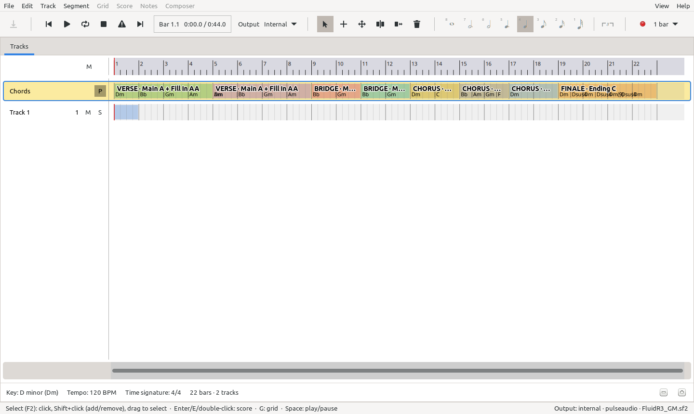


Every generated part is a normal track: change its instrument, edit its notes, mute it, or export the whole arrangement
as a standard MIDI file.

The **Chord Editor** shows each chord with its exact position, root, type and bass, quantizes the chords you played live,
and chooses style, section and final fill for each segment.

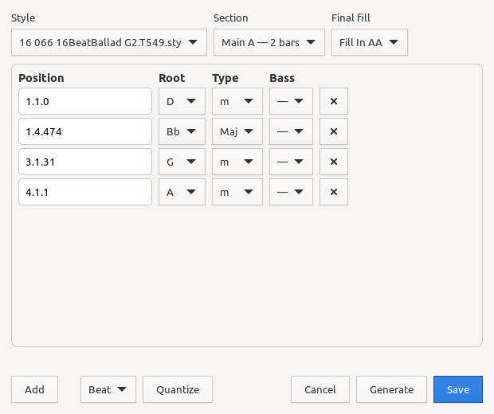


### Your keyboard's styles, opened up

Open a Yamaha style (`.sty`, `.prs`, `.sst`, `.fps`, `.bcs`, SFF1 and SFF2) and see it as a song: one track per part,
one segment per section.

Listen to each section, change instruments and sounds, rewrite the notes, and save your version as a `.stile` file: the
original stays untouched for your keyboard.

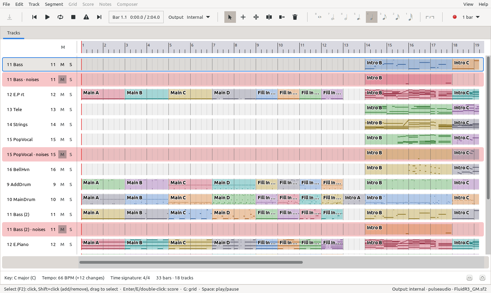


### Piano roll and real sheet music, in sync

Edit the same notes in a **grid** or directly **on the staff**, with the note-value palette (keys `1`–`8`), triplets
and the on-screen piano.

The notation is real engraving: key and time signatures, ties, slurs, staccato, triplets, automatic beaming and chord
symbols, drawn with the SMuFL font Bravura.


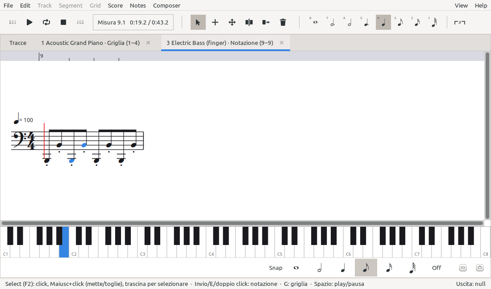

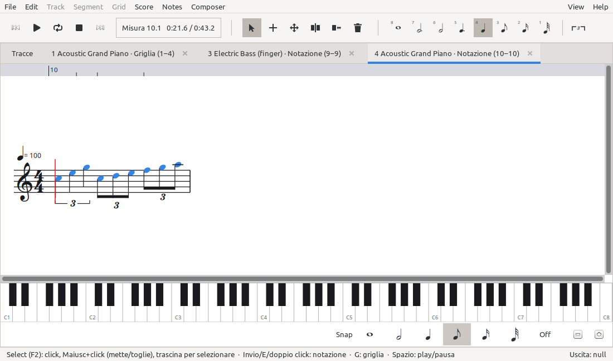

Drums get their own grid, with the General MIDI name of every key.


Notes menu: Transpose (semitones, octaves, scale steps), Quantize, Velocity with Humanize, Tie, Slur, Staccato.
The **Event Editor** lists notes, controllers, pitch bend and aftertouch for fine editing.


### Chords and guitar strums

Write a whole chord by name, or a **guitar chord** from the chord book (`x32010`) with its real notes and a **down or up
strum** that sounds like a guitar.

**Detect Chords** writes the chord symbols of the notes you played.


### Tracks and linked segments

Arrange the song in tracks and segments: move, split, resize, merge and label them with the tools `F2`–`F7`.

**Duplicate** and **Paste** create **clones**: change the notes of one and all of them change, until you make it
independent.

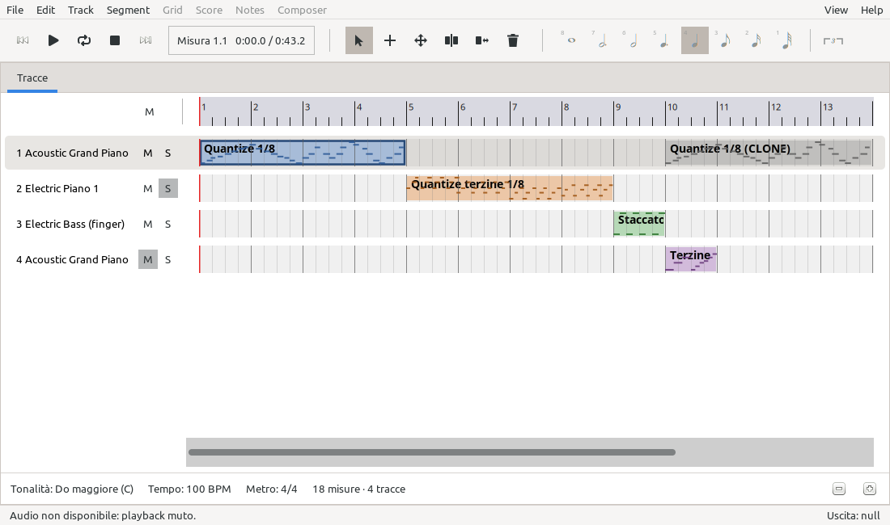

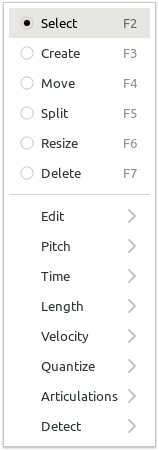

Each track has its clef, General MIDI instrument or drum kit, MIDI channel, default velocity, Mute and Solo.
The song has tempo, key and time-signature changes, a copyright notice and free-text Song Notes.


### Your sounds, your hardware

Play through the **built-in synthesizer** (FluidSynth, any `.sf2` / `.sf3` SoundFont) or send to your **keyboards,
expanders and synths** through MIDI ports.

Each track can use a different sound on each output: a preset from any SoundFont on the built-in synth, a sound chosen
**by name** on your keyboard.

The **Roland FANTOM EX** sound list is included: about 7,200 sounds, expansions too.

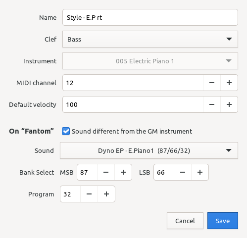

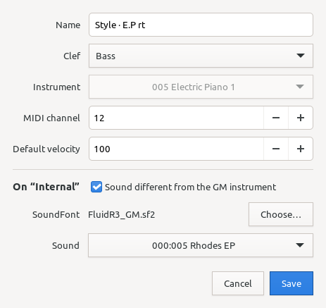

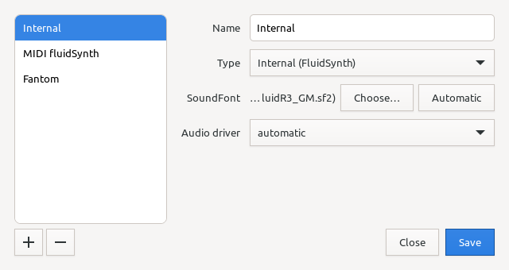


### Record from your MIDI keyboard

Play on your keyboard and hear it at once with the sound of the selected track; press **Rec** to record, with count-in
(or *Wait for note*) and metronome.

Notes, sustain pedal, controllers and pitch bend are recorded.

On Linux, **Audio Loopback** plays a USB keyboard's audio through the computer's headphones, together with the
built-in synth.

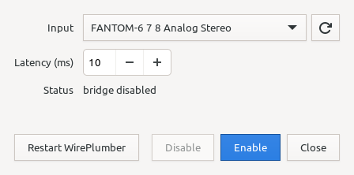


### File formats

| Format                                               | Open                                           | Save               |
|------------------------------------------------------|------------------------------------------------|--------------------|
| Canovaccio project `.music`                          | yes                                            | yes                |
| Customised style `.stile`                            | yes                                            | yes                |
| Standard MIDI `.mid`, `.midi`                        | yes                                            | yes (Save as MIDI) |
| MuseScore `.mscz`, `.mscx` (2.x, 3.x, 4.x)           | yes                                            | —                  |
| MusicXML `.musicxml`, `.mxl`, `.xml`                 | yes                                            | —                  |
| Rosegarden `.rg`                                     | yes                                            | —                  |
| Yamaha styles `.sty`, `.prs`, `.sst`, `.fps`, `.bcs` | yes                                            | —                  |
| Chord Looper `.clb`                                  | as a new song, or Track › Import Chord Looper… | —                  |

Imports keep only what Canovaccio can represent: for example repeats, dynamics, lyrics and ornaments of a score are
skipped, and its bars are read once, in written order.

Save as MIDI exports the song exactly as it sounds.


## Install the binary


### Linux

Canovaccio for Linux is a single AppImage file: nothing to install, the GTK libraries and a General MIDI SoundFont
(TimGM6mb) are inside.

It runs on 64-bit PCs (x86_64) with Ubuntu 24.04, Linux Mint 22, Debian 13, Fedora 40 or newer.

Download `Canovaccio-X.Y.Z-x86_64.AppImage` from the [latest release](https://github.com/badpenguin/canovaccio/releases/latest),
make it executable and start it:

```bash
chmod +x Canovaccio-*-x86_64.AppImage
./Canovaccio-*-x86_64.AppImage
```

You can also make it executable from the file manager (Properties › Permissions) and open it with a double click.

If it does not start because FUSE is missing, run it with `--appimage-extract-and-run`.

If a SoundFont is installed on your system, Canovaccio uses that one instead of the built-in TimGM6mb
(see [SoundFont](#soundfont)).

The first time it starts, Canovaccio offers to add itself to the applications menu: see
[Desktop integration](#desktop-integration-linux).


### Windows

> **Not tested yet.** The Windows version is built automatically, but I haven't tried it myself: I work on Linux.
> If you try it, please tell me whether it works, or what goes wrong, by opening an
> [issue](https://github.com/badpenguin/canovaccio/issues).

Canovaccio for Windows is a zip file with the program folder: nothing to install, the GTK libraries and a General MIDI
SoundFont (TimGM6mb) are inside. It runs on Windows 10 and 11, 64-bit.

Download `Canovaccio-X.Y.Z-windows-x86_64.zip` from the
[latest release](https://github.com/badpenguin/canovaccio/releases/latest), extract it, open the `Canovaccio` folder and
start `canovaccio.exe`.

The program is not signed, so the first time Windows SmartScreen warns about an unknown publisher: click
**More info › Run anyway**.

The first time it starts, Canovaccio installs its music notation font (Bravura) for your user, without administrator
rights.


### macOS

> **Not tested yet.** The macOS version is built automatically, but I haven't tried it myself: I work on Linux.
> If you try it, please tell me whether it works, or what goes wrong, by opening an
> [issue](https://github.com/badpenguin/canovaccio/issues).

Canovaccio for macOS runs on Macs with Apple Silicon (M1 or newer) and macOS 15 Sequoia or newer.
Macs with an Intel processor are not supported.

Download `Canovaccio-X.Y.Z-macos-arm64.dmg` from the [latest release](https://github.com/badpenguin/canovaccio/releases/latest),
open it and drag Canovaccio into Applications.

The app is not notarized by Apple, so the first time macOS refuses to open it. Open **System Settings › Privacy &
Security**, scroll down to the message about Canovaccio, click **Open Anyway** and confirm.

If macOS says the app "is damaged and can't be opened", run this once in the Terminal, then open it again:

```bash
xattr -dr com.apple.quarantine /Applications/Canovaccio.app
```

On the Mac the keyboard shortcuts use `Cmd` where this page says `Ctrl`.


## Install from source

These instructions are for Linux.

Requirements: Python **3.12** or newer, GTK **4**, PyGObject, FluidSynth.

**Ubuntu 24.04 / Debian 13**

```bash
sudo apt install git python3-venv python3-gi python3-gi-cairo gir1.2-gtk-4.0 libfluidsynth3 fluid-soundfont-gm
```

**Fedora**

```bash
sudo dnf install git python3-gobject gtk4 fluidsynth-libs fluid-soundfont-gm
```

**Arch Linux**

```bash
sudo pacman -S git python-gobject gtk4 fluidsynth soundfont-fluid
```

Then get the code and create the Python environment. The environment uses the system's PyGObject and pycairo, so it is
created with `--system-site-packages`:

```bash
git clone https://github.com/badpenguin/canovaccio.git
cd canovaccio
python3 -m venv --system-site-packages .venv
.venv/bin/pip install mido pyfluidsynth python-rtmidi
```

Start it with the launcher script, from any folder:

```bash
./canovaccio.sh                      # empty window: use File › Open…
./canovaccio.sh examples/small.mid   # opens a MIDI file, score, style or project
```

The script runs the same as `.venv/bin/python -m editor` from the `canovaccio` folder.

The first time, Canovaccio offers to add itself to the applications menu: see
[Desktop integration](#desktop-integration-linux).


### SoundFont

The built-in synthesizer needs a General MIDI **SoundFont** (`.sf2` or `.sf3`); without one it stays silent.
Installed from source, Canovaccio doesn't ship one (the AppImage does). There are two ways to get it.

**From your package manager.** The commands above already install FluidR3 GM (about 140 MB). For a smaller one:

```bash
sudo apt install timgm6mb-soundfont     # Ubuntu / Debian, about 6 MB
```

**By hand, without administrator rights.** Download a SoundFont and copy it into `~/.local/share/soundfonts/`:

| SoundFont | Size | License | Where to get it |
|---|---|---|---|
| MuseScore General | about 36 MB (`.sf3`) | MIT | [MuseScore download folder](https://ftp.osuosl.org/pub/musescore/soundfont/MuseScore_General/) |
| GeneralUser GS | about 30 MB | free, see its license | [author's page](https://schristiancollins.com/generaluser.php) |
| More free SoundFonts | | | [FluidSynth wiki: SoundFont](https://github.com/FluidSynth/fluidsynth/wiki/SoundFont) |

Canovaccio looks in `/usr/share/sounds/sf2`, `/usr/share/soundfonts`, `/usr/share/sounds/sf3` and
`~/.local/share/soundfonts`. You can also pick any SoundFont file in **File › Output Devices…**.


| Python package  | Used for                         |
|-----------------|----------------------------------|
| `mido`          | reading and writing MIDI files   |
| `pyfluidsynth`  | the built-in synthesizer         |
| `python-rtmidi` | MIDI input and output ports      |
| `pytest`        | tests (developers only)          |

To run the tests:

```bash
.venv/bin/pip install pytest
.venv/bin/python -m pytest
```


## Desktop integration (Linux)

The first time it starts, Canovaccio asks whether to add itself to your desktop. With **Yes** it:

- adds Canovaccio to the applications menu (Sound & Video), with its icon;
- shows its icon on projects (`.music`), customised styles (`.stile`), Yamaha styles (`.sty`) and Chord Looper banks
  (`.clb`) in the file manager, and opens projects and styles with a double click;
- installs the `canovaccio` command in `~/.local/bin`: a link to the AppImage, or to `canovaccio.sh` when installed
  from source.

A checkbox in the same dialog also makes Canovaccio the default app for MIDI, MusicXML, MuseScore, Yamaha style and Chord
Looper files;
without it, Canovaccio only shows up in their "Open With" menu.

Everything goes in your home folder: no administrator rights are needed.

With **No** it doesn't ask again.

To change your answer, use **Help › Desktop Integration…**: it installs, updates or removes everything.

When you download a new version of the AppImage, or move it, start it once: the `canovaccio` link follows it and the menu
keeps working.

Notes:

- If the `canovaccio` command is not found in a terminal, `~/.local/bin` is not in your PATH: on many systems it is
  enough to log out and back in.
- LaTeX also uses `.sty`: LaTeX files keep their own type, because a Yamaha style is recognised by its content
  (it starts like a MIDI file).
- If the file manager still shows the old icons, close it (`nemo -q` on Cinnamon, `nautilus -q` on GNOME) and open the
  folder again.


## How to use it


### The window

From top to bottom:

- **Menus**: File, Edit, Track, Segment, Grid, Score, Notes, Composer, View, Help. Only the menus that apply to the tab in
  front are active.
- **Toolbar**, in palettes:
  - Save, active when there are unsaved changes;
  - player: go to start, Play / Pause (`Space`), Play in loop, Stop, Panic, next segment, position;
  - tools: Select `F2`, Create `F3`, Move `F4`, Split `F5`, Resize `F6`, Delete `F7`;
  - note values, for the notation editor;
  - the output in use, and Rec for recording.
- **Tabs**: "Tracks" is always there; each grid or notation editor you open gets its own tab (`Ctrl+W` closes it; on Tracks it closes the song).
- **Bottom bar**: song data (key, tempo, time signature; double-click to edit them) or Snap and zoom in the editors.
- **Status line**: hints, error messages and the active audio output.

Mouse wheel, the same in every view: wheel = along the timeline, `Shift`+wheel = up/down, `Ctrl`+wheel = zoom
(also `Ctrl` `+` / `-` / `0`). Click the ruler to move the play position.


### Tracks and segments

- **Double-click a track name** for its properties: name, clef, instrument (or drums), MIDI channel, default velocity,
  and the sound to use on each output.
- **M** and **S** next to the name: Mute and Solo (Solo is exclusive).
- **Right-click a track name** (or the Track menu): Add Track `Ctrl+T`, Delete Track, Reorder, Select All Segments.
- With **Select**: click a segment to select it, `Shift`+click to add or remove it, drag on empty space for a rectangle.
- With **Create** drag on an empty lane to draw a new segment; **Move**, **Split**, **Resize** and **Delete** work on the
  segment you click.
- **Right-click a segment** (or the Segment menu): Duplicate `Ctrl+D`, Make Independent (clones only), Merge, Label… `L`,
  Import MIDI…, and the editors that fit the segment: Grid, Notation and Event Editor for notes (no Notation for drums),
  Chord Editor for the chord track.
- `Ctrl+C` / `Ctrl+X` and `Ctrl+V` paste **clones** at the red play line, on the highlighted track; `Ctrl+Shift+V` pastes
  independent copies.
- To copy between songs, copy in the first one, open the second and paste: segments arrive as independent copies,
  starting on the highlighted track. Copied notes can be pasted in another song's grid or score too.
- `G` opens the **grid** of the selected segments, `E` (or `Enter`, or a double-click) their **notation**.


### Editing notes

The same tools and the Notes menu work in the grid and in the notation:

- **Create** `F3`: in the grid drag to draw a note; on the staff click where the note goes, with the value chosen in the
  palette (`1` = 1/32 … `8` = whole note, plus the triplet switch).
- **Select**: click, `Shift`+click, rectangle; drag notes to move them. Arrow keys: `↑`/`↓` semitone,
  `Ctrl+↑`/`↓` octave, `←`/`→` one Snap step.
- **Length**: `Ctrl` `+` / `-` on the keypad doubles or halves, `Ctrl+.` adds or removes a dot.
- **Paste** `Ctrl+V` puts the copied notes at the red play line, in the grid as on the staff (and segments in Tracks too).
- **Notes menu**: Duplicate, Merge, Transpose…, Quantize to Snap, Quantize…, Velocity…, Tie / Untie, Staccato, Slur,
  Detect Staccato.
- **Double-click a note** for its properties: pitch, spelling, velocity, start, length, tie.
- **Snap** (bottom bar): 1/1 … 1/32 or Off, separate for grid and notation.
- Notes can't leave their segment and can't overlap a note of the same pitch: when an edit is not possible the editor
  shows where the notes would go in red and explains why.


### Chords

The **Composer** menu writes whole chords in the grid or in the notation, at the red play line.

- **Composer › Chord…**: root, type, additions (6, 7, maj7, 9, 11, 13, add9), close or open voicing, octave.
- **Composer › Chord Symbol…**: free text above the staff.
- **Composer › Detect Chords**: writes the symbols of the chords played by the selected notes.

The chord goes on the red play line and the line moves on, so you can write one chord after another.

The dialog stays open: press **Insert** for each chord, **Close** (or `Esc`) when you are done.

The length of the chord is the note value of the palette (notation) or the Snap (grid).

The chord symbol is written by itself above the staff, only where the chord changes.


### Guitar chords

**Composer › Guitar Chord…** writes the chord as a guitarist plays it, with the notes of the six strings, not a block of
stacked thirds.

1. Choose **Root** (A … G) and **Type**: major, minor, 7, m7, maj7.
2. The dialog shows the shape as in a chord book, for example `x32010` for C (`x` = string not played), whether it is an
   open chord or a barre (e.g. "barre at fret 3 (E shape)"), and the real notes, from the low string up.
3. Choose **Strum**: none, down (low to high) or up (high to low).
4. Press **Insert**: the chord goes on the red play line, which moves on to the end of the chord.

A strummed chord sounds like a guitar: the strings start one after another, 20 ms apart, and stop together. This is kept in
Save as MIDI too.

In the notation a ⊓ (down) or V (up) above the chord shows the strum.

`examples/strum-test.music` and `examples/ballad-strum.music` are two examples.


### Styles: open and customise

Canovaccio opens the accompaniment styles of Yamaha arranger keyboards (`.sty`, `.prs`, `.sst`, `.fps`, `.bcs`), so you
can see, hear and change them.

1. **File › Open…** and choose the style (try the included `examples/demo.sty`).
2. Each **part** of the style becomes a track, named after its channel and part ("10 Rhythm", "11 Bass", "12 Piano"…).
3. Each **section** becomes a segment, labelled with its name: Intro A, Main A, Main B, Fill In AA, Ending A…
4. Play (`Space`) plays the sections one after another; `E` or `G` on a segment shows its notes.


To customise it:

- double-click a track name to change the instrument, or the sound used on each output (see below);
- edit the notes of a section in the grid or in the notation, as in any song;
- **File › Save** (`Ctrl+S`) saves a **`.stile`** file next to the original: the `.sty` stays untouched for your keyboard.

A `.stile` opens again with File › Open… and can be used as a style of a song, with your instruments and sounds.

Song Notes (File › Song Notes…) describe how each part follows the chords, as written in the style.

Yamaha "Mega Voice" noises (guitar fret noises, slaps…) go to a separate muted track "… · noises".

Drum kits that have no General MIDI equivalent are listed in the Song Notes and in the status line.


### Chord Looper and accompaniment

The **chord track** turns a chord progression into a full accompaniment, using the song's styles.

**1. Get the chords.** Two ways:

- Open a Chord Looper bank (`.clb`), saved by a Yamaha keyboard with the Chord Looper function: **File › Open…** makes
  a new song with it, **Track › Import Chord Looper…** adds it to the open song. Every memory of the bank (up to 8)
  becomes a segment of the "Chords" track, "Memory 1", "Memory 2"…, one after the other from bar 1. If the song has no
  notes, its key is guessed from the chords.
- Or highlight the "Chords" row in the Tracks tab, press **Rec** and play the chords on your MIDI keyboard. As on an
  arranger keyboard, the notes are not kept: they become chords (C, Am7, F/A…), on the nearest eighth.


**2. Choose the styles.** Double-click the "Chords" name (or **Track › Song Styles…**): in **Song styles** press **Add…**
and choose one or more `.sty` or `.stile` files. Here you also set the channel used by the chord Preview.

**3. Edit the chords.** Double-click a chord segment to open the **Chord Editor**:

- at the top, **Style**, **Section** (e.g. "Main A — 4 bars") and **Final fill** (it replaces the last bars of the segment);
- the list of chords: position (bar.beat.tick), root, type, bass for slash chords; **Add** and ✕ to add and remove one;
- **Quantize** moves the chords to the nearest beat, eighth or bar (played chords are rarely on the beat).


**4. Generate.** **Generate** in the Chord Editor writes the accompaniment of that segment; **Track › Generate All (style)**
does it for every chord segment.

The result goes into the **"Style · …"** tracks (one for each part: drums, bass, chords, pad, phrase), with a segment for
each chord segment, labelled like "Main A + Fill In AA". These are normal tracks: change instruments, edit notes,
or **File › Save as MIDI…** to get a MIDI file of the whole arrangement.


Generating again replaces only what is in that stretch of the "Style · …" tracks. `Ctrl+Z` undoes it in one step.

**P** on the chord track plays the chords alone (Preview), to check them before generating.


Yamaha does not publish the style (`.sty`…) and Chord Looper (`.clb`) formats: Canovaccio reads them following the
documentation written by the user community, and the accompaniment it generates is an approximation of what a Yamaha
keyboard plays. Yamaha is a trademark of Yamaha Corporation; Canovaccio is not affiliated with Yamaha.


### Output devices

Canovaccio plays through the **built-in synth** (FluidSynth with a SoundFont) or through a **MIDI port**: an external
keyboard, an expander, a software synth.

**File › Output Devices…** lists the outputs. With **+** add one, give it a **Name** (shown in the Output menu and in
the track properties) and a **Type**:

- **Internal (FluidSynth)**: the **SoundFont** (Choose… a `.sf2` / `.sf3` file, or Automatic) and the **Audio driver**
  (automatic, or one of FluidSynth's).
- **MIDI port**: the system's **Port** (↻ rescans the ports); **Send Program Change**, to send each track's instrument at
  Play (some devices don't want it); the **Sound list** of the device, to choose its sounds by name (see below).

**Save** keeps the outputs in the program's preferences, not in the song. A port that is not connected stays in the list,
marked "(not connected)".

The **Output** menu next to the player chooses the output in use, even during Play. The status line shows it.

**Panic** (toolbar) silences everything and resets the controllers.


Environment variables, used when the built-in synth is set to "Automatic": `CANOVACCIO_SF2` (SoundFont file) and
`CANOVACCIO_AUDIO_DRIVER` (FluidSynth audio driver).


### A different sound for a track

By default each track plays its **General MIDI** instrument, so the song sounds right on any output.

To use another sound, choose the output in the **Output** menu first, then double-click the track name: at the bottom,
**On "output name"**, tick **Sound different from the GM instrument**. The sound is saved in the song, for that output
only: the same track can use a SoundFont piano on "Internal" and a Fantom piano on "Fantom".

**On the built-in synth**, use any SoundFont, not only the default one:

1. **SoundFont › Choose…** and pick a `.sf2` or `.sf3` file (e.g. a piano or a string SoundFont downloaded from the web).
2. **Sound**: the list of its presets ("bank:program name"); type a few letters to search, `Enter` picks the first.
3. **Save**: the SoundFont is loaded next to the default one, only for that track.


**On a MIDI port**, set Bank Select **MSB**, **LSB** and **Program** (1–128, as in the manuals), or choose the sound by name
(next section). "Send Program Change" must be on for that output.

Save as MIDI exports only the General MIDI instruments, so the file sounds the same everywhere.


### Device sound lists (Roland FANTOM EX)

In Output Devices, give a MIDI port its **Sound list**: then, in the track properties, **Sound** has a search box and fills
MSB, LSB and Program for you.

Lists included:

- **GM**: the General MIDI sounds and drum kits;
- **Roland FANTOM EX**: about 7,200 sounds of the FANTOM EX and of all its expansions (EXZ, EXM, EXSN, ACB, Roland Cloud).

Searching: each word you type must be the start of a word of the name, in any order: "e guit" finds "Electric Guitar" and
"Guitar Electric". On a drum track (channel 10) the list shows only the drum kits.

Sounds of expansions that are not installed on your keyboard simply don't play.


**Roland FANTOM EX user sounds** aren't in the sound list (they are yours): in the track properties, under On "Fantom", type
the three numbers. With the number the Fantom shows (e.g. USER 0001):

| User sound type      | MSB | LSB                               | PC                        |
|----------------------|-----|-----------------------------------|---------------------------|
| User Tone (ZEN-Core) | 87  | (number − 1) ÷ 128, integer part  | (number − 1) mod 128, + 1 |
| User Drum Kit        | 86  | as above                          | as above                  |
| User SN-A Tone       | 89  | as above                          | as above                  |
| User V-Piano Tone    | 90  | as above                          | as above                  |

Examples: USER 0001 = 87 · 0 · 1, USER 0128 = 87 · 0 · 128, USER 0129 = 87 · 1 · 1, USER 0300 = 87 · 2 · 44.


### Audio Loopback (Linux)

Many keyboards, like the Roland FANTOM in VENDOR mode, send their audio to the computer through the USB cable. **File ›
Audio Loopback…** plays that audio in the computer's headphones or speakers, so you hear the keyboard and the built-in synth
together, without a mixer.

1. **Input**: the keyboard's USB audio (↻ rescans the inputs).
2. **Latency (ms)**: lower means less delay; raise it if you hear crackles.
3. **Enable**: Status becomes "bridge enabled". **Disable** removes it.

The bridge goes to the default output and follows it when you switch to headphones. It stays on after you close Canovaccio,
until you press Disable or restart the computer.

The input and the latency are remembered for next time.

If the keyboard's input is missing from the list, try **Restart WirePlumber**.

It needs PulseAudio or PipeWire (`pactl`), as on most Linux desktops.


### MIDI keyboard and recording

- **File › Input Device…** chooses the MIDI input port. What you play is heard at once with the sound of the selected track
  (set Local Off on the keyboard if it is also the output).
- **Rec** records on the selected track, in the free space from the bar of the play position. Count-in: 2 bars, 1 bar,
  or *Wait for note*; the metronome plays during recording.
- Notes, sustain pedal, controllers and pitch bend are recorded. The **Event Editor** (Segment menu) lists them for
  fine editing.

The selected track is the one of the editor in front, otherwise the row highlighted in the Tracks tab.

The input port is remembered and opens again at the next start.

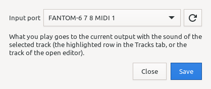


### Files

- **File › Open…** opens projects, and imports MIDI files, scores, Rosegarden projects and styles. **Open Recent** keeps the
  last 10 files. The file that was open when you closed the program opens again at the next start.
- **File › Save** / **Save As…** save a `.music` project; **Save as MIDI…** exports the song as it sounds.
- **File › Close** (`Ctrl+W`) closes the editor tab in front; on the Tracks tab it closes the song.
- **File › Song Properties…**: tempo, key and time-signature changes, and the copyright notice.
- **File › Song Notes…**: free text saved with the song (imports also write useful information here).
- **View › Theme**: the system GTK theme, or another installed GTK 4 theme.


### Keyboard shortcuts

On macOS, use `Cmd` instead of `Ctrl`.

| Key | Action |
|---|---|
| `Space` | Play / Pause |
| `F2` … `F7` | Select, Create, Move, Split, Resize, Delete |
| `G` / `E` (`Enter`) | open the grid / notation of the selected segments |
| `Ctrl+Z` / `Ctrl+Shift+Z` | Undo / Redo |
| `Ctrl+X` / `Ctrl+C` / `Ctrl+V` | Cut / Copy / Paste (segments: Paste creates clones) |
| `Ctrl+Shift+V` | Paste independent copies |
| `Ctrl+D` | Duplicate |
| `Ctrl+A` | Select all (notes in an editor, segments of the track in Tracks) |
| `Ctrl+T` | Add Track |
| `L` | Label the selected segments |
| `Delete` | delete the selection |
| `1` … `8` | note value (notation) |
| `↑` / `↓`, `Ctrl+↑` / `↓` | semitone, octave |
| `←` / `→` | one Snap step |
| `Ctrl` `+` / `-` (keypad), `Ctrl+.` | double, halve, dot |
| `Ctrl+W` | close the editor tab, or the song on the Tracks tab |
| `Ctrl+Q` | quit |


## License

Canovaccio is free software, released under the **GNU General Public License version 3 or later**
(GPL-3.0-or-later): see [LICENSE](LICENSE).

It uses or includes:

| Component | License | Notes |
|---|---|---|
| GTK 4, PyGObject | LGPL-2.1 or later | system libraries |
| Cairo, pycairo | LGPL-2.1 or MPL-1.1 | system libraries |
| FluidSynth, pyfluidsynth | LGPL-2.1 or later | built-in synthesizer |
| mido | MIT | MIDI files |
| python-rtmidi | MIT | MIDI ports |
| Python | PSF License | |
| **Bravura** font (SMuFL, in `editor/resources/fonts/`) | SIL Open Font License 1.1 | by Steinberg; text in `OFL.txt` |
| General MIDI definition from **Rosegarden** (`editor/resources/instruments/rosegarden/GM.rgd`) | GPL-2.0 or later | |
| pytest (tests only) | MIT | |

The **Roland FANTOM EX** sound list (`editor/resources/instruments/roland-fantom-ex.json`) holds the sound names and numbers
(MSB / LSB / PC) taken from Roland's official *FANTOM-6EX/7EX/8EX Sound List* and the Sound Lists of its expansions
(EXZ, EXM, EXSN, ACB), published on the
[Roland FANTOM EX support page](https://www.roland.com/global/support/by_product/fantom_8_ex/owners_manuals/).
Roland and FANTOM are trademarks of Roland Corporation.

SoundFonts and Yamaha factory styles are not included: Canovaccio uses the ones installed on your system or your own.
