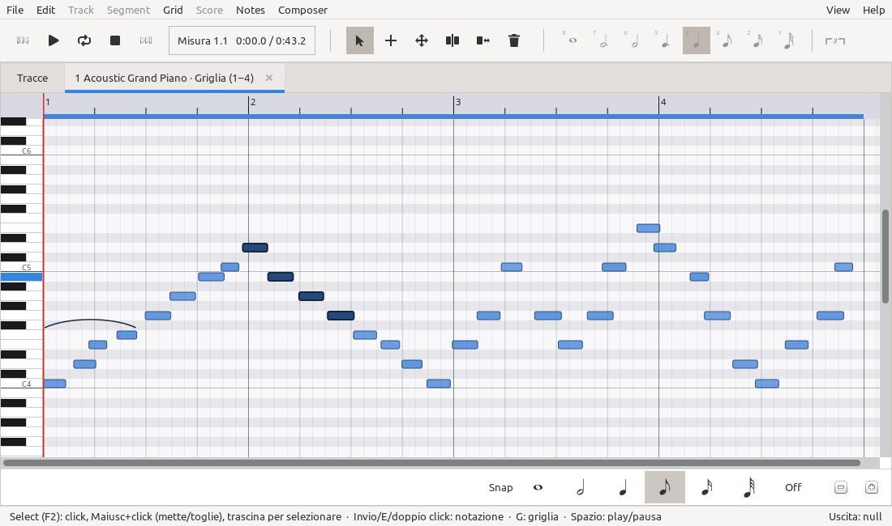
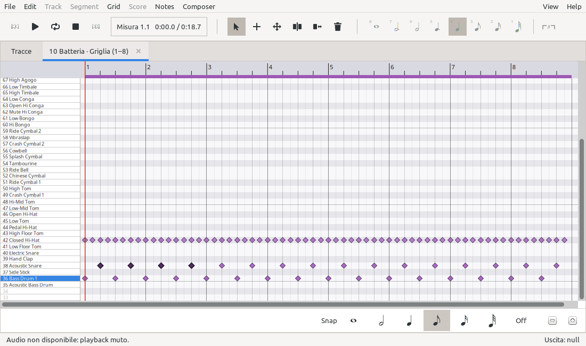
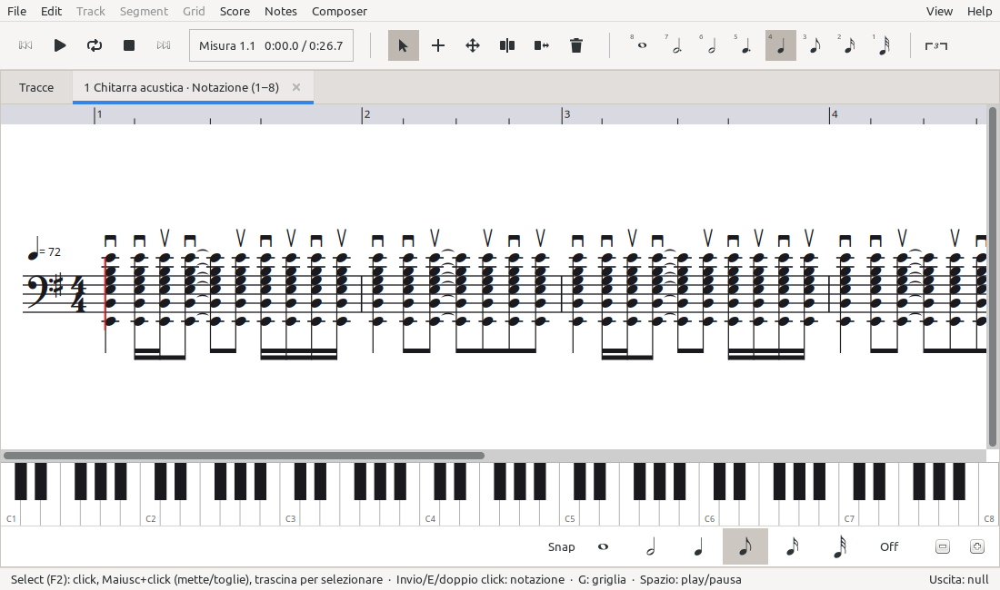
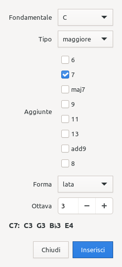
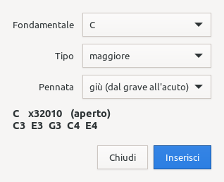

# Canovaccio

**Compose, arrange and play: tracks and linked segments, piano roll and real notation in sync, chords and guitar
chords with strum, chord track with Yamaha style accompaniment, MIDI keyboard recording, import from MIDI, MuseScore,
MusicXML and Rosegarden.**

Runs on Linux today; Windows and macOS versions are planned.

Canovaccio opens your MIDI files, scores and keyboard styles, lets you edit them as a grid or as sheet music, and plays
them through its built-in synthesizer or through your hardware keyboard. It is written in Python with GTK 4 and follows your
desktop's GTK theme.

How it was built: [Building a music editor in Python and GTK 4: exact time, real notation and reverse-engineered
styles](https://medium.com/@antoniogallo.it/building-a-music-editor-in-python-and-gtk-4-exact-time-real-notation-and-reverse-engineered-43151bddffa2)
(Medium).


## What it does

- **Arrange** your song in tracks and segments: move, split, resize, merge, label, duplicate as linked copies (clones).
- **Edit notes** in a piano-roll **grid** or directly on the **staff**: create, move, transpose, quantize, tie, slur,
  staccato, velocity — with full undo/redo.
- **Read and write real notation**: key and time signatures, ties, triplets, automatic beaming, chord symbols,
  drawn with the SMuFL font Bravura.
- **Write chords fast**: insert a chord by name, a guitar chord from the chord book (with strum), or let the editor
  **detect the chords** from the notes you played.
- **Accompany yourself**: a **chord track** plus **Yamaha styles** generate drums, bass and chords that follow your
  chord progression.
- **Play it anywhere**: built-in FluidSynth synthesizer with any SoundFont, or external MIDI ports, with a different sound
  per output (Roland FANTOM EX sound list included).
- **Record from your MIDI keyboard**, with count-in and metronome.
- **Open many formats**: MIDI, MuseScore (2.x–4.x), MusicXML, Rosegarden, Yamaha styles, Chord Looper banks.
  **Export** to standard MIDI exactly as it sounds.


## Features


### Tracks and segments

| | |
|---|---|
| Tracks | name, clef, General MIDI instrument or drum kit, MIDI channel, default velocity, Mute / Solo |
| Segments | Select, Create, Move, Split, Resize, Delete tools (`F2`–`F7`), multi-track selection |
| Linked copies | Duplicate and Paste create **clones**: change the notes of one, all of them change |
| Editing | Cut / Copy / Paste, Paste Independent, Merge, Make Independent, Label |
| Song | tempo, key and time-signature changes, copyright notice, free-text Song Notes |


### Grid and notation editors

| | |
|---|---|
| Grid (piano roll) | draw, move and resize notes, play keys on the on-screen piano, drum grid with General MIDI names |
| Notation | edit on the staff, note-value palette (keys `1`–`8`), triplets, on-screen piano to enter notes one after another |
| Notes menu | Transpose (semitones, octaves, scale steps), Quantize, Velocity with Humanize, Tie, Slur, Staccato |
| Composer | Chord…, Guitar Chord… (with strum), Chord Symbol…, Detect Chords |
| Event Editor | notes, controllers, pitch bend and aftertouch as an editable list |









### Chord track and styles

| | |
|---|---|
| Chord track | one per song, filled from a **Chord Looper** bank (`.clb`) or recorded from your keyboard |
| Chord Editor | each chord with its position, root, type and bass; Quantize; style, section and final fill for each segment |
| Generate | writes the style's accompaniment into "Style · …" tracks, following the chords and the song key |
| Styles | Yamaha `.sty`, `.prs`, `.sst`, `.fps`, `.bcs` (SFF1 and SFF2); customised styles saved as `.stile` |


### Sound

| | |
|---|---|
| Built-in synth | FluidSynth with any `.sf2` / `.sf3` SoundFont |
| MIDI ports | send to external keyboards, expanders and synths; choose sounds by name from the port's sound list |
| Per-output sounds | each track can use a different sound on each output (SoundFont preset or Bank Select + Program Change) |
| Panic | stops every note and resets volume, pan and effects on all channels |
| Audio Loopback | hear a USB keyboard's audio through the PC headphones (PulseAudio / PipeWire) |


### File formats

| Format | Open | Save |
|---|---|---|
| Canovaccio project `.music` | yes | yes |
| Customised style `.stile` | yes | yes |
| Standard MIDI `.mid`, `.midi` | yes | yes (Save as MIDI) |
| MuseScore `.mscz`, `.mscx` (2.x, 3.x, 4.x) | yes | — |
| MusicXML `.musicxml`, `.mxl`, `.xml` | yes | — |
| Rosegarden `.rg` | yes | — |
| Yamaha styles `.sty`, `.prs`, `.sst`, `.fps`, `.bcs` | yes | — |
| Chord Looper `.clb` | File › Import Chord Looper… | — |

Imports keep only what Canovaccio can represent: for example repeats, dynamics, lyrics and ornaments of a score are
skipped, and its bars are read once, in written order.


## Install the binary (AppImage)

Coming soon.


## Install from source

Requirements: Python **3.12** or newer, GTK **4**, PyGObject, FluidSynth.

**Ubuntu 24.04 / Debian 13**

```bash
sudo apt install git python3-venv python3-gi python3-gi-cairo gir1.2-gtk-4.0 libfluidsynth3 fluid-soundfont-gm
```

**Fedora**

```bash
sudo dnf install git python3-gobject gtk4 fluidsynth-libs fluid-soundfont-gm
```

**Arch Linux**

```bash
sudo pacman -S git python-gobject gtk4 fluidsynth soundfont-fluid
```

Then get the code and create the Python environment. The environment uses the system's PyGObject and pycairo, so it is
created with `--system-site-packages`:

```bash
git clone https://github.com/badpenguin/canovaccio.git
cd canovaccio
python3 -m venv --system-site-packages .venv
.venv/bin/pip install mido pyfluidsynth python-rtmidi
```

Start it with the launcher script, from any folder:

```bash
./canovaccio.sh                      # empty window: use File › Open…
./canovaccio.sh examples/small.mid   # opens a MIDI file, score, style or project
```

The script runs the same as `.venv/bin/python -m editor` from the `canovaccio` folder.


### Menu launcher (Cinnamon)

To start Canovaccio from the Cinnamon menu, with its icon, run these commands from the `canovaccio` folder.

They write a launcher in `~/.local/share/applications/` that points to this folder:

```bash
cat > ~/.local/share/applications/io.github.badpenguin.Canovaccio.desktop <<EOF
[Desktop Entry]
Type=Application
Name=Canovaccio
Comment=MIDI sequencer with grid, notation, chord track and Yamaha styles
Exec=$PWD/canovaccio.sh %f
Icon=$PWD/editor/resources/icons/hicolor/scalable/apps/io.github.badpenguin.Canovaccio.svg
Terminal=false
Categories=AudioVideo;Audio;Midi;Sequencer;Music;
MimeType=audio/midi;audio/x-midi;application/vnd.recordare.musicxml+xml;application/vnd.recordare.musicxml;application/x-musescore;
StartupWMClass=io.github.badpenguin.Canovaccio
StartupNotify=true
EOF
update-desktop-database ~/.local/share/applications
```

Canovaccio then appears in the menu under Sound & Video; right-click it to add it to the panel or the desktop.

It also shows up in the file manager's "Open With" for MIDI, MusicXML and MuseScore files.

If you move the `canovaccio` folder, run the commands again.

The same launcher works on the other Linux desktops (GNOME, KDE, Xfce, MATE).


### SoundFont

The built-in synthesizer needs a General MIDI **SoundFont** (`.sf2` or `.sf3`); without one it stays silent.
Canovaccio doesn't ship one. There are two ways to get it.

**From your package manager.** The commands above already install FluidR3 GM (about 140 MB). For a smaller one:

```bash
sudo apt install timgm6mb-soundfont     # Ubuntu / Debian, about 6 MB
```

**By hand, without administrator rights.** Download a SoundFont and copy it into `~/.local/share/soundfonts/`:

| SoundFont | Size | License | Where to get it |
|---|---|---|---|
| MuseScore General | about 36 MB (`.sf3`) | MIT | [MuseScore download folder](https://ftp.osuosl.org/pub/musescore/soundfont/MuseScore_General/) |
| GeneralUser GS | about 30 MB | free, see its license | [author's page](https://schristiancollins.com/generaluser.php) |
| More free SoundFonts | | | [FluidSynth wiki: SoundFont](https://github.com/FluidSynth/fluidsynth/wiki/SoundFont) |

Canovaccio looks in `/usr/share/sounds/sf2`, `/usr/share/soundfonts`, `/usr/share/sounds/sf3` and
`~/.local/share/soundfonts`. You can also pick any SoundFont file in **File › Output Devices…**.


| Python package  | Used for                         |
|-----------------|----------------------------------|
| `mido`          | reading and writing MIDI files   |
| `pyfluidsynth`  | the built-in synthesizer         |
| `python-rtmidi` | MIDI input and output ports      |
| `pytest`        | tests (developers only)          |

To run the tests:

```bash
.venv/bin/pip install pytest
.venv/bin/python -m pytest
```


## How to use it


### The window

From top to bottom:

- **Menus**: File, Edit, Track, Segment, Grid, Score, Notes, Composer, View, Help. Only the menus that apply to the tab in
  front are active.
- **Toolbar**, in palettes:
  - player: go to start, Play / Pause (`Space`), Play in loop, Stop, Panic, next segment, position;
  - tools: Select `F2`, Create `F3`, Move `F4`, Split `F5`, Resize `F6`, Delete `F7`;
  - note values, for the notation editor;
  - the output in use, and Rec for recording.
- **Tabs**: "Tracks" is always there; each grid or notation editor you open gets its own tab (`Ctrl+W` closes it).
- **Bottom bar**: song data (key, tempo, time signature; double-click to edit them) or Snap and zoom in the editors.
- **Status line**: hints, error messages and the active audio output.

Mouse wheel, the same in every view: wheel = along the timeline, `Shift`+wheel = up/down, `Ctrl`+wheel = zoom
(also `Ctrl` `+` / `-` / `0`). Click the ruler to move the play position.


### Tracks and segments

- **Double-click a track name** for its properties: name, clef, instrument (or drums), MIDI channel, default velocity,
  and the sound to use on each output.
- **M** and **S** next to the name: Mute and Solo (Solo is exclusive).
- **Right-click a track name** (or the Track menu): Add Track `Ctrl+T`, Delete Track, Reorder, Select All Segments.
- With **Select**: click a segment to select it, `Shift`+click to add or remove it, drag on empty space for a rectangle.
- With **Create** drag on an empty lane to draw a new segment; **Move**, **Split**, **Resize** and **Delete** work on the
  segment you click.
- **Right-click a segment** (or the Segment menu): Duplicate `Ctrl+D`, Make Independent, Merge, Label… `L`,
  Event Editor, Import MIDI….
- `Ctrl+C` / `Ctrl+X` and `Ctrl+V` paste **clones** at the mouse pointer; `Ctrl+Shift+V` pastes independent copies.
- `G` opens the **grid** of the selected segments, `E` (or `Enter`, or a double-click) their **notation**.


### Editing notes

The same tools and the Notes menu work in the grid and in the notation:

- **Create** `F3`: in the grid drag to draw a note; on the staff click where the note goes, with the value chosen in the
  palette (`1` = 1/32 … `8` = whole note, plus the triplet switch).
- **Select**: click, `Shift`+click, rectangle; drag notes to move them. Arrow keys: `↑`/`↓` semitone,
  `Ctrl+↑`/`↓` octave, `←`/`→` one Snap step.
- **Length**: `Ctrl` `+` / `-` on the keypad doubles or halves, `Ctrl+.` adds or removes a dot.
- **Notes menu**: Duplicate, Merge, Transpose…, Quantize to Snap, Quantize…, Velocity…, Tie / Untie, Staccato, Slur,
  Detect Staccato.
- **Double-click a note** for its properties: pitch, spelling, velocity, start, length, tie.
- **Snap** (bottom bar): 1/1 … 1/32 or Off, separate for grid and notation.
- Notes can't leave their segment and can't overlap a note of the same pitch: when an edit is not possible the editor
  shows where the notes would go in red and explains why.


### Chords

- **Composer › Chord…**: root, type, additions (6, 7, maj7, 9, 11, 13, add9), close or open voicing, octave.
- **Composer › Guitar Chord…**: the chord-book shape (e.g. `x32010`) with real guitar notes, strummed down or up.
- **Composer › Chord Symbol…**: free text above the staff.
- **Composer › Detect Chords**: writes the symbols of the chords played by the selected notes.

The chord goes on the red play line and the line moves on, so you can write one chord after another.






### Chord track and styles

1. **File › Import Chord Looper…** turns a Chord Looper bank into the song's chord track, or press Rec with the "Chords" row
   highlighted and play the chords on your keyboard.
2. Double-click the "Chords" name to add the **styles** of the song (`.sty`… or `.stile`).
3. Double-click a chord segment to open the **Chord Editor**: choose style, section ("Main A — 4 bars") and final fill,
   correct the chords, then **Generate**.
4. **Track › Generate All (style)** regenerates every chord segment. **P** on the chord track previews the chords alone.

To customise a style, open the `.sty` with File › Open…, change instruments, sounds or notes, and save it: it becomes a
`.stile` file next to the original, which stays untouched for your keyboard.

The included `examples/demo.sty` is a small 8-beat style to try this out.

Yamaha does not publish the style (`.sty`…) and Chord Looper (`.clb`) formats: Canovaccio reads them following the
documentation written by the user community, and the accompaniment it generates is an approximation of what a Yamaha
keyboard plays. Yamaha is a trademark of Yamaha Corporation; Canovaccio is not affiliated with Yamaha.


### Sound outputs

- **File › Output Devices…**: the built-in synth (SoundFont and audio driver) and your MIDI ports.
- The **Output** menu next to the player chooses the output in use.
- In the track properties, **On "output"** sets a sound for that output: a SoundFont preset for the built-in synth, or a
  sound chosen by name (or Bank Select + Program Change) for a MIDI port.
- **Panic** (toolbar) silences everything and resets the controllers.

Environment variables, used when the built-in synth is set to "automatic": `CANOVACCIO_SF2` (SoundFont file) and
`CANOVACCIO_AUDIO_DRIVER` (FluidSynth audio driver).

**Roland FANTOM EX user sounds** aren't in the sound list (they are yours): in the track properties, under On "Fantom", type
the three numbers. With the number the Fantom shows (e.g. USER 0001):

| User sound type | MSB | LSB | PC |
|---|---|---|---|
| User Tone (ZEN-Core) | 87 | (number − 1) ÷ 128, integer part | (number − 1) mod 128, + 1 |
| User Drum Kit | 86 | as above | as above |
| User SN-A Tone | 89 | as above | as above |
| User V-Piano Tone | 90 | as above | as above |

Examples: USER 0001 = 87 · 0 · 1, USER 0128 = 87 · 0 · 128, USER 0129 = 87 · 1 · 1, USER 0300 = 87 · 2 · 44.


### MIDI keyboard and recording

- **File › Input Device…** chooses the MIDI input port. What you play is heard at once with the sound of the selected track
  (set Local Off on the keyboard if it is also the output).
- **Rec** records on the selected track, in the free space from the bar of the play position. Count-in: 2 bars, 1 bar,
  or *Wait for note*; the metronome plays during recording.
- Notes, sustain pedal, controllers and pitch bend are recorded. The **Event Editor** (Segment menu) lists them for
  fine editing.


### Files

- **File › Open…** opens projects, and imports MIDI files, scores, Rosegarden projects and styles. **Open Recent** keeps the
  last 10 files.
- **File › Save** / **Save As…** save a `.music` project; **Save as MIDI…** exports the song as it sounds.
- **File › Song Properties…**: tempo, key and time-signature changes, and the copyright notice.
- **File › Song Notes…**: free text saved with the song (imports also write useful information here).
- **View › Theme**: the system GTK theme, or another installed GTK 4 theme.


### Keyboard shortcuts

| Key | Action |
|---|---|
| `Space` | Play / Pause |
| `F2` … `F7` | Select, Create, Move, Split, Resize, Delete |
| `G` / `E` (`Enter`) | open the grid / notation of the selected segments |
| `Ctrl+Z` / `Ctrl+Shift+Z` | Undo / Redo |
| `Ctrl+X` / `Ctrl+C` / `Ctrl+V` | Cut / Copy / Paste (segments: Paste creates clones) |
| `Ctrl+Shift+V` | Paste independent copies |
| `Ctrl+D` | Duplicate |
| `Ctrl+A` | Select all (notes in an editor, segments of the track in Tracks) |
| `Ctrl+T` | Add Track |
| `L` | Label the selected segments |
| `Delete` | delete the selection |
| `1` … `8` | note value (notation) |
| `↑` / `↓`, `Ctrl+↑` / `↓` | semitone, octave |
| `←` / `→` | one Snap step |
| `Ctrl` `+` / `-` (keypad), `Ctrl+.` | double, halve, dot |
| `Ctrl+W` | close the editor tab |
| `Ctrl+Q` | quit |


## License

Canovaccio is free software, released under the **GNU General Public License version 3 or later**
(GPL-3.0-or-later): see [LICENSE](LICENSE).

It uses or includes:

| Component | License | Notes |
|---|---|---|
| GTK 4, PyGObject | LGPL-2.1 or later | system libraries |
| Cairo, pycairo | LGPL-2.1 or MPL-1.1 | system libraries |
| FluidSynth, pyfluidsynth | LGPL-2.1 or later | built-in synthesizer |
| mido | MIT | MIDI files |
| python-rtmidi | MIT | MIDI ports |
| Python | PSF License | |
| **Bravura** font (SMuFL, in `editor/resources/fonts/`) | SIL Open Font License 1.1 | by Steinberg; text in `OFL.txt` |
| General MIDI definition from **Rosegarden** (`editor/resources/instruments/rosegarden/GM.rgd`) | GPL-2.0 or later | |
| pytest (tests only) | MIT | |

The **Roland FANTOM EX** sound list (`editor/resources/instruments/roland-fantom-ex.json`) holds the sound names and numbers
(MSB / LSB / PC) taken from Roland's official *FANTOM-6EX/7EX/8EX Sound List* and the Sound Lists of its expansions
(EXZ, EXM, EXSN, ACB), published on the
[Roland FANTOM EX support page](https://www.roland.com/global/support/by_product/fantom_8_ex/owners_manuals/).
Roland and FANTOM are trademarks of Roland Corporation.

SoundFonts and Yamaha factory styles are not included: Canovaccio uses the ones installed on your system or your own.
